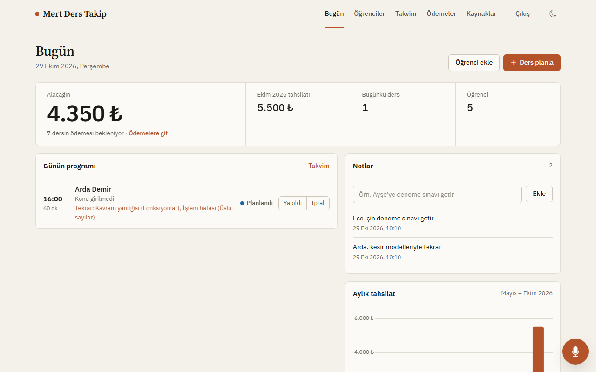
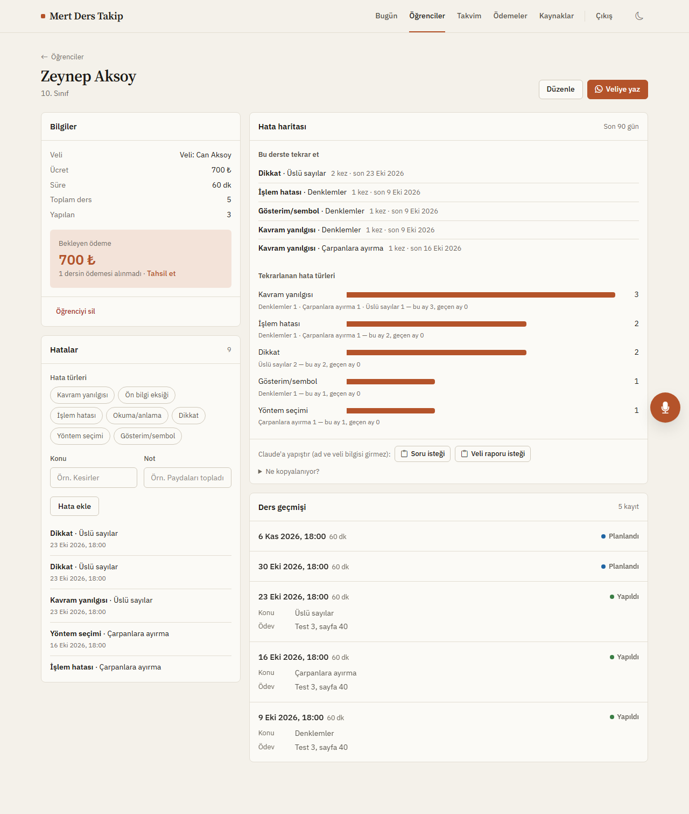
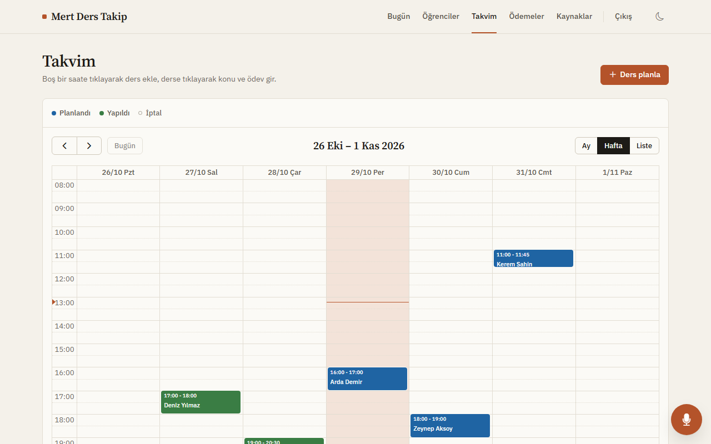
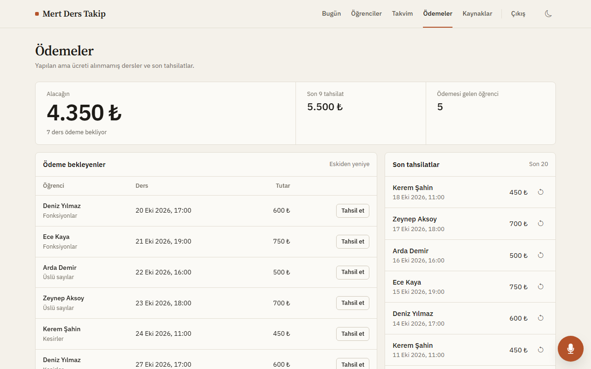
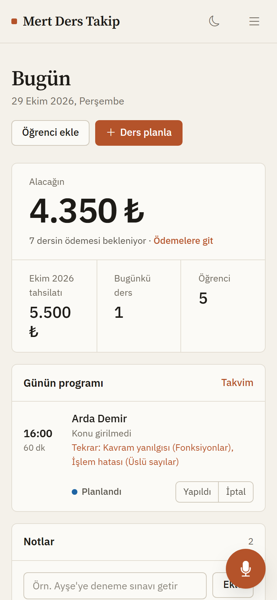

# Özel Ders Takip Uygulaması

Kendi matematik özel derslerimde öğrencileri, ders programını, ödemeleri ve öğrencilerin yaptığı hataları tek yerden yönetmek için yazdığım web uygulaması. Her gün gerçek kullanımda.

**Canlı:** [mert-ders.onrender.com](https://mert-ders.onrender.com) (giriş gerektirir; öğrenci verisi gizli)

*A Flask + PostgreSQL web app I built and use daily to run my private math tutoring: students, schedule, payments, a mistake-tracking module with spaced repetition, and a rule-based Turkish voice command parser.*

## Ekran görüntüleri

*Görüntüler sahte demo verisiyle alındı; gerçek öğrenci bilgisi içermez.*

**Bugün:** alacak, aylık tahsilat, günün programı ve o gün tekrar edilmesi gereken hatalar


**Öğrenci profili ve Hata Haritası:** hata türleri, konular, aralıklı tekrar listesi, ders geçmişi


**Takvim**


**Ödemeler**




## Ne yapıyor

- **Öğrenciler:** sınıf, veli iletişimi, saatlik ücret, varsayılan ders süresi, notlar.
- **Takvim:** ders ekleme, taşıma, silme; "yapıldı" ya da "iptal" işaretleme; ders konusu ve ödev kaydı.
- **Ödemeler:** yapılan derslerden borç hesabı, ödeme işaretleme, yanlış işaretlemeyi geri alma.
- **Kaynaklar ve not defteri:** sınıf seviyesine göre kaynak linkleri, hızlı notlar.
- **Hata Haritası:** öğrencinin hatalarını konudan bağımsız 7 türe ayırarak kaydeder (kavram yanılgısı, ön bilgi eksiği, işlem, okuma, dikkat, strateji, gösterim). Profilde hangi türün ve konunun öne çıktığını gösterir, aralıklı tekrar (1 → 3 → 7 → 14 gün) ile hangi hatanın bugün tekrar edilmesi gerektiğini önerir.
- **Türkçe sesli komut:** tarayıcıda konuşulan cümleyi işleme çevirir. Yapay zeka servisi kullanmayan, kendi yazdığım kural tabanlı bir çözümleyici (`voice.py`): öğrenci adını bulanık eşleştirir, Türkçe tarih ve saat ifadelerini ("önümüzdeki cuma beşi çeyrek geçe", "8 hafta boyunca her perşembe") çözer.

| Cümle | Sonuç |
|---|---|
| "Ayşe ile 8 hafta boyunca her perşembe 18'de" | 8 haftalık ders tek seferde eklenir |
| "Ayşe'nin dersi bitti, konusu üslü sayılar, ödevi sayfa 40" | Ders yapıldı, konu ve ödev kaydedilir |
| "Mehmet bugün gelmedi" | Ders iptal edilir |
| "Ali'nin cumartesi 17'deki dersini pazar 15'e kaydır" | Ders taşınır |
| "Ayşe kesirlerde işlem hatası yaptı" | Hata Haritası'na kayıt düşer |

## Teknik

- **Backend:** Python, Flask, Gunicorn
- **Veritabanı:** PostgreSQL (canlıda Supabase), yerelde SQLite. `database.py` iki veritabanını aynı arayüzle sarar; canlıda bağlantı havuzu kullanır.
- **Frontend:** Jinja şablonları, vanilla JavaScript, açık/koyu tema, telefonda kullanılabilir düzen
- **Yayın:** Render

```
app.py         rotalar ve iş mantığı
database.py    PostgreSQL / SQLite bağlantısı, bağlantı havuzu
schema.sql     tablolar: students, lessons, payments, resources, quick_notes, mistakes
voice.py       Türkçe sesli komut çözümleyici
hata.py        Hata Haritası analizi ve aralıklı tekrar (veritabanından bağımsız saf fonksiyonlar)
```

## Yerelde çalıştırma

```bash
python -m venv venv
source venv/bin/activate        # Windows: venv\Scripts\activate
pip install -r requirements.txt
python app.py
```

`DATABASE_URL` tanımlı değilse uygulama yerel bir SQLite dosyası açar. Canlı ortamda `DATABASE_URL`, `SECRET_KEY` ve `ADMIN_PASSWORD` ortam değişkenleri gerekir.

## Gizlilik

Repoda öğrenci verisi yoktur; veritabanı dosyaları `.gitignore` ile dışarıda tutulur. Hata Haritası'nın soru ve veli raporu metinleri öğrenci adı ve veli bilgisi içermeden üretilir.
